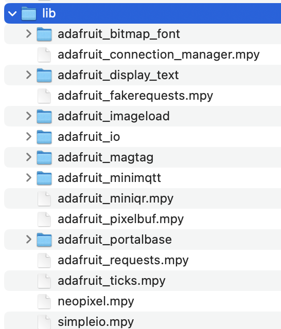

# `magtag-mbta-display`

[](https://www.hannahilea.com/blog/houseplant-programming)

Project write-up: [Personal public transit display on a MagTag](https://hannahilea.com/blog/magtag-mbta-display)

Code for a real-time public transit display on an Adafruit MagTag, featuring a custom configuration of MBTA stops and routes.

Thanks to John Park's https://learn.adafruit.com/magtag-showerthoughts/code-the-magtag-showerthoughts-viewer, which I used as a starting point for programming the MagTag.

> Caveat: As of 11 Nov 2026, the battery indicator is not accurate. Present, and trending in the correct direction, but not accurate! :)

## Set-up

On an [Adafruit MagTag](https://www.adafruit.com/product/4800):

1. **Board set-up:** Follow these [MagTag set-up instructions](https://learn.adafruit.com/adafruit-magtag/update-tinyuf2-bootloader-for-circuitpython-10-4mb-boards-only) through installing CircuitPython 10.3.0 on your MagTag. 

2. **Library set-up:** Download the necessary [CircuitPython libraries](https://circuitpython.org/libraries), and copy the following directories and files to a `lib` directory on your board:
    

    (Does this list seem excessive? Could it be pared down? Probably/probably! Houseplant code.)

2. **Code set-up:** Copy the [`code.py`](./code.py), [`mbta_routes.json`](./mbta_routes.json), and [`settings.toml`](./settings.toml) files here to the top-level directory of the MagTag.

5. **Application set-up:** Update the copied-over `settings.toml` on your MagTag with:
    1. The WIFI network name and password for the installation site
    2. The username and key for your [Adafruit.io](https://io.adafruit.com/) account. If you don't have one yet, you can make one for free [here](https://learn.adafruit.com/welcome-to-adafruit-io/getting-started-with-adafruit-io). This is used for providing time/date info for the display.

6. **Route configuration:** Update the copied-over `mbta_routes.json` on your MagTag with the routes you want to track---unless you happen to live right exactly in Union Square, Somerville (!), a la the default routes already in this file. :)
    
    Each entry in the routes list should follow the form 
    ```
    {
        "label": "FOO",
        "url": "https://api-v3.mbta.com/predictions/?filter[route]=ROUTE_NAME&filter[stop]=STOP_NUMBER&sort=direction_id,departure_time"
    }
    ```
    If you alter the url anything other than `ROUTE_NAME` and `STOP_NUMBER` in that URL, the displayed times might not be correct.

    - **To find your routes + stops**, go to https://www.mbta.com/schedules and click through to your desired line and then stop. Once you're on the page for that stop, the `STOP_NUMBER` is in the URL. 
        - E.g., for https://www.mbta.com/stops/1723 the `STOP_NUMBER` is 1723. If you click from that page onto a specific line, you'll get both numbers in the URL, e.g., https://www.mbta.com/stops/1723?route=28&direction_id=1&headsign=Ruggles, which gives `ROUTE_NAME` 28 and `STOP_NUMBER` 1723.
        
            Multiple routes will share a `STOP_NUMBER` if multiple routes pass through the same stop!

        - What is the `ROUTE_NAME`? Bus lines are usually (always?) the bus route's number, irrespective of direction; T lines are usually (always?) their color, e.g. `Green-D`;  it looks like the commuter rail is something like `CR-Haverhill`; the ferry probably has a similar convention.

        - If you run into trouble with using the mbta's site to figure out your stop numbers, you can use https://transitfind.com/ with your browser's dev panel to watch the request sent when you choose a stop; that request will contain the stop and route.

Once powered, the MagTag should display the "sleeping" message; hit any button along the bottom to wake it up and have it display your routes!

If a given route lists no times, it means no imminent departures are planned (i.e., the MBTA API returned no upcoming departures).
If it shows "???" it means a departure is planned but unscheduled, i.e., the MBTA API returned departures without times. I've seen the ??? behavior primarily at the termini for the Green Line.

Caveats:

- You can include as many routes as you'd like in `mbta_routes.json`, although the display as originally designed only fits ~5 nicely. To display more, you may need to futz around with the layouts and font sizes in `code.py` to get everything to display nicely. 
- Similar deal with each route's label: it can be as long as you like, but if it's longer than ~16 characters it might not look good and you might need to update the styling.
